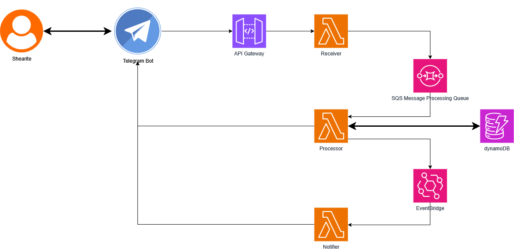

# Sheares Bot

Sheares Bot gives residents a friendly Telegram interface for interacting within their block, automating the day-to-day routines they share, for instance laundry machines and sticker packs. Provisioned on AWS using Lambda, API Gateway, DynamoDB and EventBridge Scheduler, with Terraform.

## System Architecture



The bot is built entirely on AWS using an event-driven, serverless architecture. 

*   **Ingestion:** A Shearite sends a message to the Telegram Bot, which forwards the update via webhook to an API Gateway.
*   **Bot Lambda:** API Gateway invokes the single bot function. `src/app.py` sees a webhook event, routes the update to the matching handler, and returns 200 to Telegram once it has been handled. Failures are logged and still acknowledged so Telegram does not retry them forever.
*   **Storage:** Handlers read and write user and machine state in DynamoDB.
*   **Scheduling:** When a user starts a time-delayed action (like a laundry cycle), the bot creates a one-off EventBridge schedule.
*   **Notification:** When the schedule fires, EventBridge invokes the same function with a job event (`{"job": "laundry_done", "payload": {...}}`), and the job handler messages the user.

The diagram still shows the earlier three-function layout.

## Database Schema (DynamoDB)

The bot utilizes Amazon DynamoDB for fast, serverless state management. The data is organized into two primary tables:

### 1. Users Table (`<env>-db-table-sheareswebbot-users`)
Stores resident profiles and tracks their active facility usage.
*   **Partition Key (PK):** `userID` (The user's unique Telegram ID)
*   **Sort Key (SK):** `profile` (The type of record, e.g., `PROFILE` for user demographics and block info, or `LAUNDRY` to track a set of machines currently claimed by the user)

### 2. Laundry Machines Table (`<env>-db-table-sheareswebbot-laundry-machines`)
Maintains the real-time state and ownership of all washing machines and dryers across the hall.
*   **Partition Key (PK):** `block` (The hall block, e.g., `A`, `B`, `C`)
*   **Sort Key (SK):** `machineID` (The specific machine identifier, e.g., `W1`, `D3`)

## Code Structure

```
src/
  app.py          Lambda entrypoint and local polling entrypoint; routing only
  core/           config, router, Telegram client, schedulers, DynamoDB tables
  features/
    profile/      handlers.py, repository.py
    laundry/      handlers.py, service.py, repository.py
tests/            pytest suite (moto for AWS, a fake Telegram client)
```

Each feature splits into three layers. `handlers.py` owns everything Telegram-shaped: message text, keyboards, parsing `callback_data`. `service.py` holds the rules and never imports Telegram. `repository.py` is the only module that talks to DynamoDB. A feature without real rules (like `profile`) skips `service.py`.

All code ships in one Docker image (see `Dockerfile`) run by one Lambda with handler `app.lambda_handler`.

## Adding a Command

Register handlers with the decorators in `core/router.py`. A command or button handler receives a `Context` with `user_id`, `chat_id`, `text`, `data`, `message_id`, `telegram` and `scheduler`.

```python
from core.router import router


@router.command("/feedback")
def feedback_command(ctx):
    kb = [[{"text": "Hall events", "callback_data": "fb_events"}]]
    ctx.telegram.send_message(ctx.chat_id, "What is your feedback about?", kb)


@router.callback("fb_")
def feedback_topic(ctx):
    ctx.telegram.edit_message(ctx.chat_id, ctx.message_id, f"Thanks! Topic: {ctx.data[3:]}")
```

Callback handlers match on a `callback_data` prefix, and the longest matching prefix wins. Registering the same command or prefix twice fails at startup. For a new feature, create `src/features/<name>/` and add its `handlers` import to `src/features/__init__.py`. Scheduled work uses `@router.job("<name>")` with a `(payload, telegram)` handler and `ctx.scheduler.schedule(name, run_at, job, payload)`; EventBridge schedule names must start with `Laundry_` until the IAM policy is widened.

## Running Locally

1.  Create your own bot with [@BotFather](https://t.me/BotFather) and copy its token. Do not use the preprod or prd bot: they have webhooks, and `make dev` refuses to poll a bot with a webhook.
2.  `cp .env.example .env` and fill it in. The table names point at real DynamoDB tables, so whatever you do locally changes those tables. Your AWS credentials need read and write access to them; uncomment `AWS_PROFILE` only if you use a named profile.
3.  `make install` once, then `make dev`. Message your bot in Telegram.

Reminders run in-process while `make dev` is running, so stopping it drops pending ones. Run the tests with `make test`; they use moto and need no AWS access.

## Current Commands

### Basic
*   `/help` or `/start` – Displays the welcome message and available commands.
*   `/profile` – Manages the user's hall profile. Users can create and view their profiles (TODO: Implement editing and adding extended profile information).

### Laundry Management
*   `/laundry` – Displays a real-time summary of washing machine and dryer statuses for the user's specific block.
*   `/wash` – Initiates a 30-minute washing cycle tracking session. 
    *   Allows users to bump/remind the previous user to collect their laundry if the machine is marked as completed but not emptied.
    *   Allows users to logically move the previous user's clothes to another machine in the database to free up the current washer.
    *   Provides a direct override option if the machine's digital state is desynced from reality.
*   `/dry` – Initiates a drying cycle with selectable durations of 30, 45, or 60 minutes. Functions similarly to `/wash` with bump, move, and override capabilities.
*   *Note: Both `/wash` and `/dry` will automatically notify the user to collect their items when the duration expires, regardless of whether their machine status was overridden by another user.*

## Roadmap & Idea Functions

*   `/book` – A facility booking system for block amenities (e.g., lounges, sports equipment).
*   `/flirt` – An anonymous messaging feature to connect residents.
*   `/feedback` – A direct, anonymous feedback channel for hall events and infrastructure reporting.